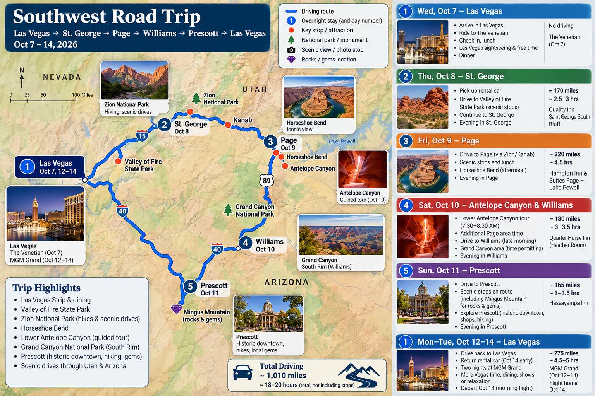
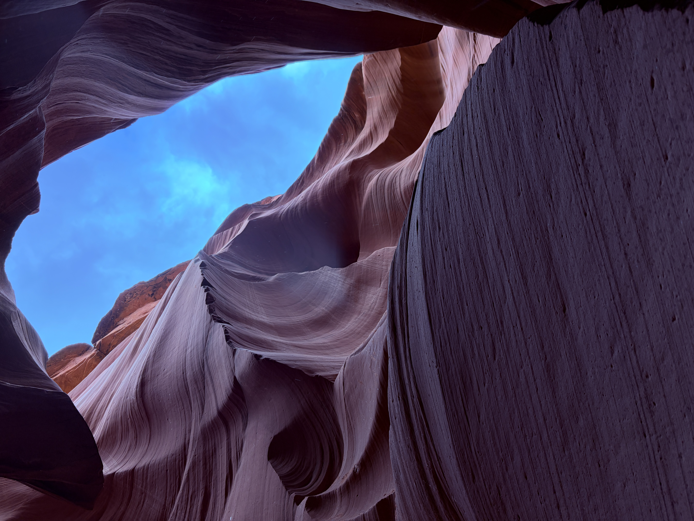
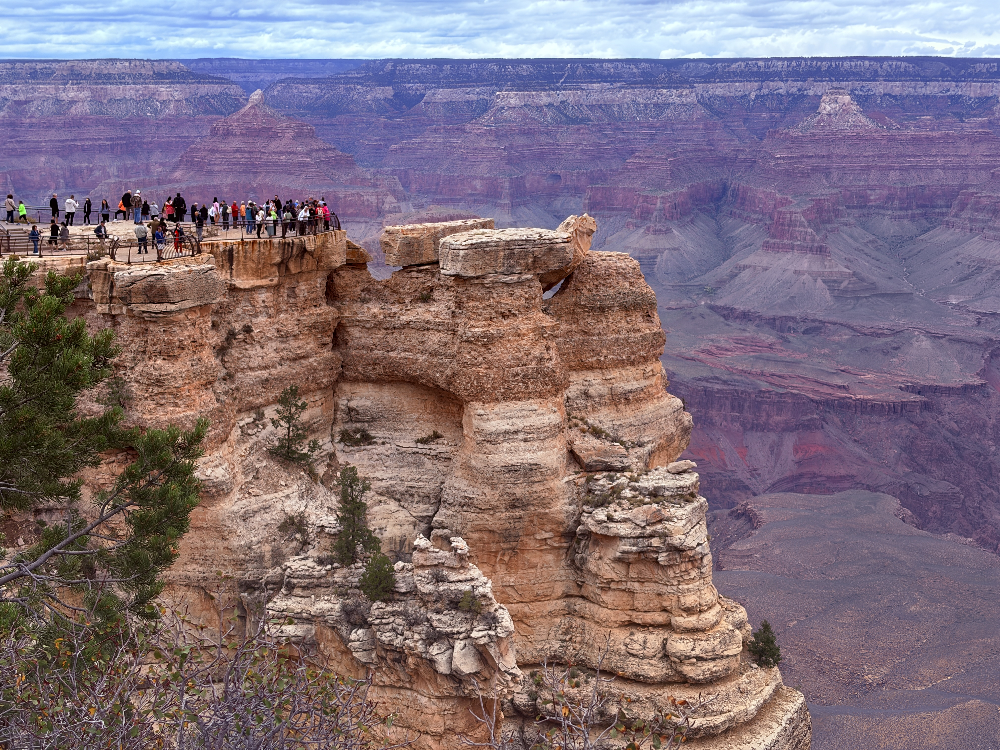
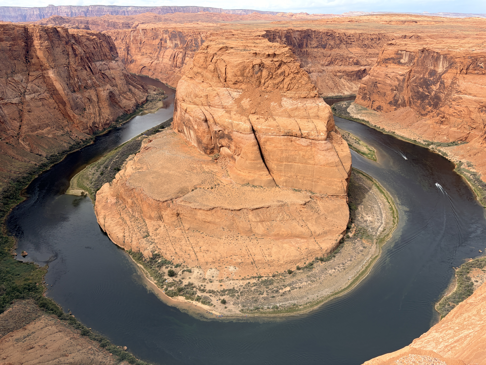
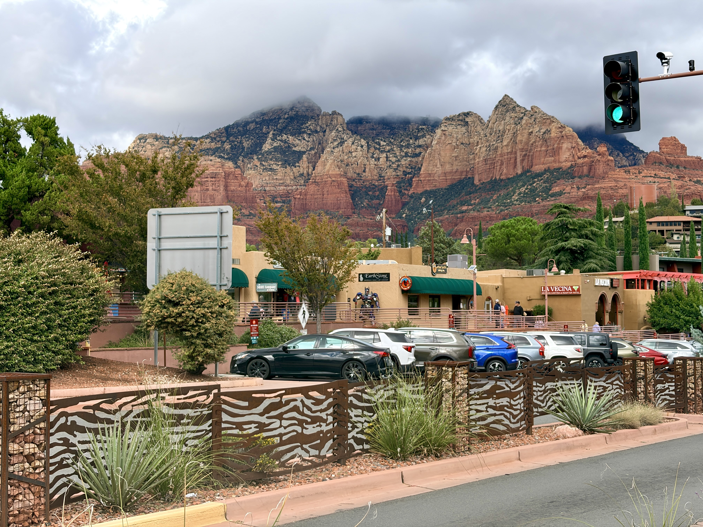
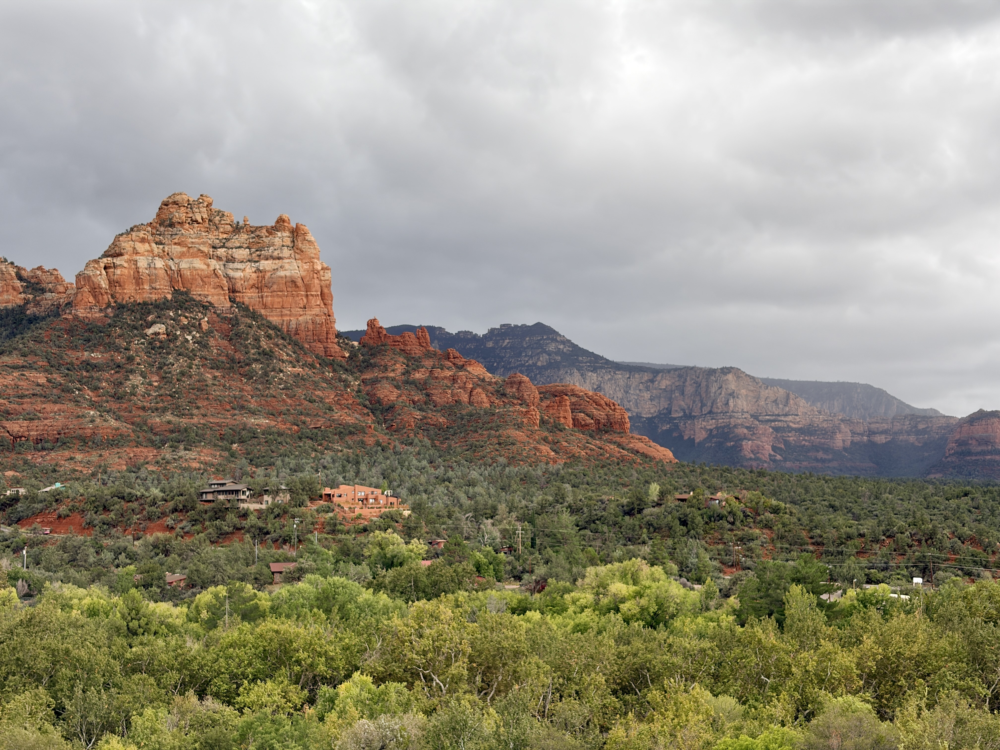
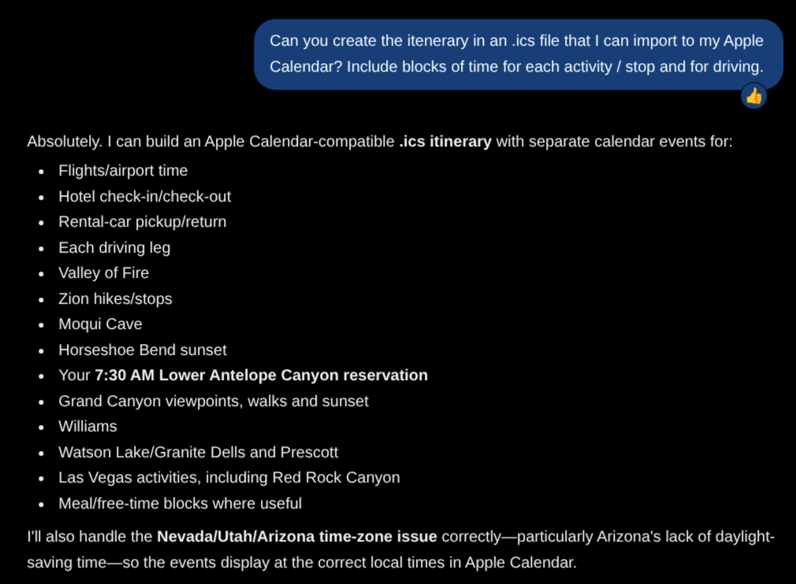
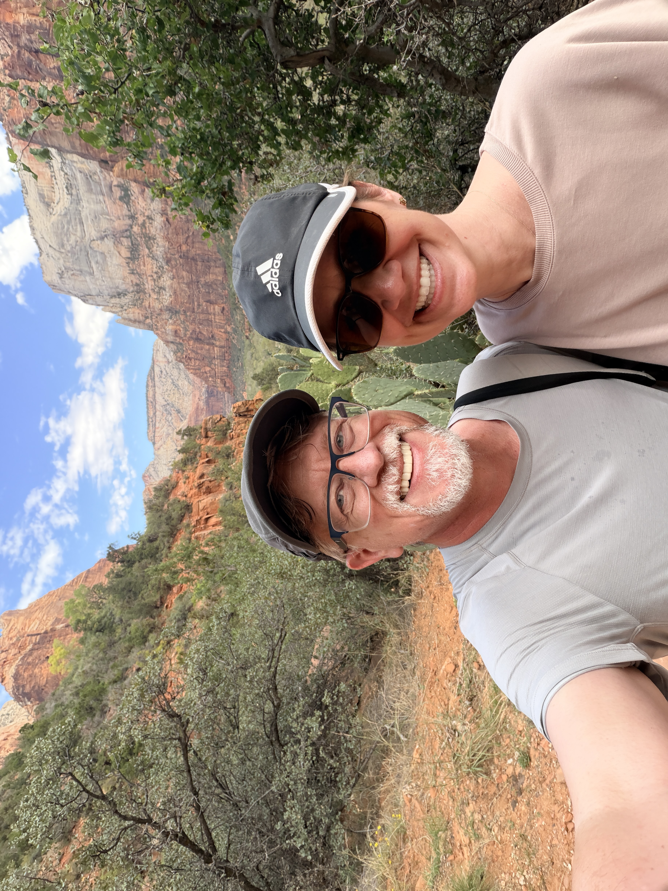

Last night, I returned home from a whirlwind, one-week vacation in the southwest U.S. area. And I have to say it was one of the best trips I ever took.

One reason is that it was the first trip with my new partner in life; more to follow in a future post on that development. 

The second reason is that I decided weeks ago to plan the trip solely with AI.

Normally, I'd [use local LLMs to do any AI project](https://kctofel.com/n/articles/ai-broke-my-blog-then-fixed-it/), but for this experiment, I decided to use ChatGPT. PayPal recently had a deal that gave me the $20 monthly GPT subscription for 6 months with a $10 monthly return credit. So I signed up and started planning my travel.

I'll get to the detailed planning and the trip experience in a minute but first I want to share some of the end result. Mainly because I was blown away. 

Once the trip plans were complete, I asked GPT to "make me a driving map of the trip." That's all I said in the prompt. I expected something very basic. However, this is what the result was:

To say that the map exceeded my basic expectations is a __severe__ understatement. GPT took all of the contextual information from trip planning and turned it into a useful visual summary of the entire trip. Well done!

Back to the planning part. GPT helped me pick some points of interest that I suggested and it also suggested some others. My partner is very into rocks and gems, so she appreciated some of these side trips that GPT suggested.

[Valley of Fire State Park](https://parks.nv.gov/parks/valley-of-fire) in Nevada and [Moqui Cave](https://en.wikipedia.org/wiki/Moqui_Cave) in Utah were both a hit with her. These were both nice additions to my choices for the trip: [Antelope Canyon](https://en.wikipedia.org/wiki/Antelope_Canyon), the [Grand Canyon](https://www.nps.gov/grca/index.htm), and [Horseshoe Bend](https://www.nps.gov/glca/planyourvisit/horseshoe-bend.htm).

Even with the trip meticulously planned, variables popped up; specifically, bad weather. We had to skip some outdoor activities one particular day as a result. 

But GPT was there at the ready and we jointly decided to add more driving and more destinations in the rain. So we got a chance to backtrack to Sedona and Flagstaff with just a bit more driving. And it was **completely** worth it.

One really nice aspect of using AI to create the trip was getting a full calendar of events that I easily imported into my phone's Calendar. I simply asked GPT to create an .ics file with the full itinerary. Not a problem.

Having a detailed list of activities and locations in my phone calendar made the trip easy peasy to experience. It also provided flexibility as needed, which came in handy during the stormy day. And using AI made the trip cost effective too.

Since GPT can search the web, I had it scour for places to stay that were both nice and within a reasonable budget. I could have done this myself but since we stayed at 6 different places across 7 different nights, having AI do the work made it far quicker.

And although I wouldn't call the lodging costs inexpensive, they were reasonable for the budget. Not only that, but we enjoyed every single place, even the [quirky but charming cabin-like room in Williams, AZ](https://www.stayporter.com/quarterhorse-inn-lodge/?amenities_filter=1205492) that GPT recommended.

All in all, I would __totally__ take the same approach and use AI for travel planning in the future. (Sorry, travel agents!) The process was simple, cost-effective and offered some unexpected "side quests" that made the entire trip super enjoyable for both of us.

